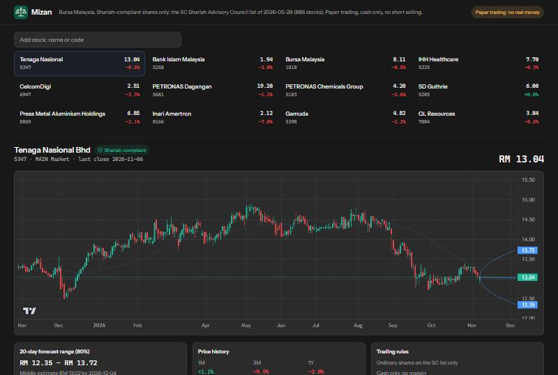
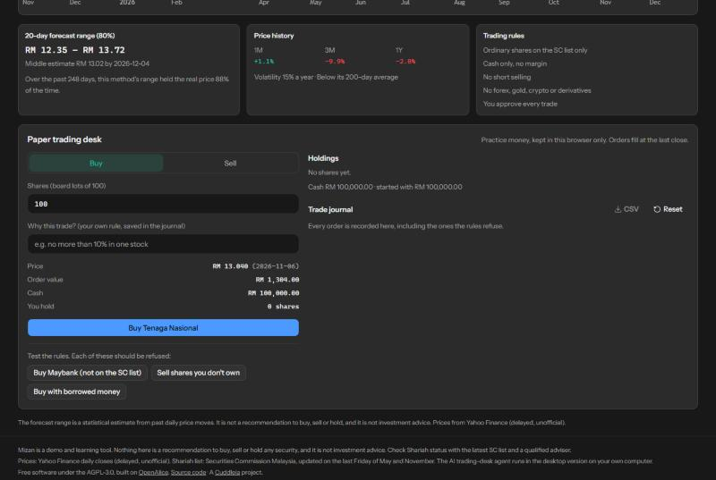

<p align="center">
  
</p>

<h1 align="center">Mizan</h1>

<p align="center">
  <strong>Shariah-compliant trading on Bursa Malaysia, with the rules enforced in code.</strong><br>
  Charts, forecast ranges, paper trading and an AI trading-desk agent that explains but never advises.
</p>

<p align="center">
  <a href="https://mizan.cuddleia.com">Try it live</a> · <a href="#run-the-desktop-version">Run the desktop version</a> · <a href="#how-the-rules-are-enforced">How the rules work</a>
</p>

<p align="center">
  
</p>

*Mizan* (ميزان) means "balance" or "scale". Most trading tools let you trade
anything and leave the Shariah check to you. Mizan works the other way: it only
knows the shares on the Securities Commission Malaysia's Shariah list, and the
things Islamic finance rules out (forex, gold contracts, crypto, derivatives,
margin, short selling and betting-style prediction markets) are refused before
an order can go through.

> **Not investment advice.** Mizan is a demo and learning tool for paper
> trading. It never tells you to buy, sell or hold a stock. Check Shariah status
> with the latest SC list and a qualified adviser.

## What you can do

- **Watch Shariah-compliant stocks.** The search only finds stocks on the
  [SC Shariah Advisory Council list](https://www.sc.com.my/development/icm/shariah-compliant-securities/list-of-shariah-compliant-securities)
  (886 stocks plus 1 Islamic business trust in the May 2026 list). Type
  "Maybank" and it tells you it is not on the list.
- **Read the chart with a forecast range.** Daily candlesticks, the 50-day
  average and a 20-day range that the price should stay inside 80% of the
  time. Mizan also shows how often that range actually held over the past year,
  so you can judge it yourself.
- **Practise with paper money.** Start with RM 100,000 and buy or sell in
  board lots of 100 shares at the last close. Nothing real is traded.
- **Keep a trade journal.** Every order is logged with your own reason for it,
  including the orders the rules refused. Export it as CSV.
- **Ask the AI desk** (desktop version). The agent looks up Shariah status,
  explains price history and forecasts, and checks a trade you propose against
  your own plan. It replies in Bahasa Malaysia or English. It stages trades for
  you to approve; it never places one by itself.

<p align="center">
  
</p>

## How the rules are enforced

Every order passes these checks before it can fill. Approving a trade does not
skip them.

| Rule | What it refuses |
|---|---|
| `shariah-sc-list` | Anything that is not an ordinary share, and buys of stocks not on the SC list. Selling is always allowed, so a stock that drops off the list can be disposed of. |
| `cash-only` | Buys that cost more than the cash on hand, or that cannot be priced. No margin. |
| `no-short` | Selling more shares than you hold. |
| board lot (web version) | Quantities that are not multiples of 100 shares. |

The AI agent works under the same limits. Its instructions and the
`mizan-shariah` skill tell it to use the SC list rather than judge compliance
itself, to quote forecasts as ranges with their hit rate, and to decline
buy/sell/hold calls. Under the SC's *Guidance Note on Provision of Investment
Advice*, a disclaimer does not make a recommendation acceptable.

In the desktop version the agent may stage a trade, but you approve every push
("Allow AI to push trades" stays off). Claude Code runs in accept-edits mode
with only the Mizan command-line tools and read-only tools pre-approved;
anything else asks you first.

## Two versions

| | Web ([mizan.cuddleia.com](https://mizan.cuddleia.com)) | Desktop (this repo, run locally) |
|---|---|---|
| Dashboard, charts, forecast ranges | ✓ | ✓ |
| Paper trading | In your browser | Simulator account with full order history |
| Trade journal | ✓ (CSV export) | ✓ (Trading as Git: every trade is a commit) |
| AI trading-desk agent | — | ✓ (uses your own Claude Code or other agent CLI) |
| Install | None | Node 22 + pnpm |

The AI is desktop-only on purpose: it runs on your own agent subscription, on
your own computer.

## Run the desktop version

Requirements: Node.js 22.19+, pnpm 11.7 (`npm i -g pnpm@11.7.0`), and an agent
CLI such as [Claude Code](https://claude.com/claude-code) signed in with your
own account.

```bash
git clone https://github.com/adamhaqeem12345-alt/mizan.git
cd mizan
pnpm install
pnpm exec turbo run build --filter='!@traderalice/desktop' --filter='!./packages/uta-broker-*'
OPENALICE_HOME=~/.openalice-mizan pnpm dev       # UI at http://localhost:47331
```

Then, in the app:

1. **Settings → Trading:** set the mode to **Pro** and keep "Allow AI to push
   trades" off.
2. **Settings → Developer → Simulator:** create a paper account and add the
   guards `shariah-sc-list`, `no-short` and `cash-only`.
3. Load the latest Bursa closing prices into the simulator. The simulator lives
   in memory, so repeat this after every restart:

   ```bash
   node mizan/scripts/sync-sim-prices.mjs
   ```

## Run the web version

```bash
pnpm install --filter 'open-alice-ui...'
pnpm --filter open-alice-ui run dev:web     # http://127.0.0.1:5180/web.html
pnpm --filter open-alice-ui run build:web   # static build in ui/dist-web
```

It deploys to Vercel with `vercel.json`: the static app plus one function,
`api/bars.js`, which serves daily prices for Bursa codes (`5347.KL`) only.

## Data sources

- **Shariah status:** the SC Shariah Advisory Council list, published on the
  last Friday of May and November. The current file is
  `mizan/data/sc-shariah-list-2026-05-29.json`; the next list is due
  **27 November 2026**.
- **Prices:** Yahoo Finance daily closes. They are delayed and unofficial, so
  they are fine for practice but not for real trading decisions.
- **Forecast:** a log-normal random walk fitted on one year of daily returns
  (`ui/src/mizan/forecast.ts`). It describes how much a price has moved, not
  which way it will go. Weekends are skipped; Malaysian public holidays are not
  yet.

### Updating the SC list

One command, with the "Total" from the SC's Table 3 as a cross-check:

```bash
# Preview the changes; writes nothing
node mizan/scripts/update-sc-list.mjs "List of Shariah-compliant securities <Month Year>.pdf" <YYYY-MM-DD> --expect-stocks <Table 3 total> --dry-run
# Apply them
node mizan/scripts/update-sc-list.mjs "List of Shariah-compliant securities <Month Year>.pdf" <YYYY-MM-DD> --expect-stocks <Table 3 total>
```

It reads the PDF through `pdftotext -raw`, compares the result with the current
list, and stops if the total doesn't match Table 3 or most of the list seems to
have vanished. Then it writes `mizan/data/sc-shariah-list-<date>.json` with a
change report (`sc-list-changes-<date>.md`: added, removed, renamed), copies the
list to the agent skill, points the guard, the web app, the tests and the cloud
API at the new file, and refreshes the cloud copy. Removed stocks can still be
sold but no longer bought. Tests: `node --test mizan/scripts/sc-list-lib.test.mjs`.

## Where things live

| Path | What |
|---|---|
| `services/uta/src/domain/trading/guards/` | `shariah-sc-list`, `no-short`, `cash-only` guards |
| `tests/integration/uta-simulation/mizan-guards.spec.ts` | Guard tests, including the real SC list |
| `ui/src/pages/MizanHomePage.tsx` | Dashboard: watchlist, chart, forecast and stats |
| `ui/src/mizan/` | Forecast maths, SC list lookup, web paper account (`paper.ts`) |
| `ui/src/mizan/web/` | Web version shell and paper trading desk |
| `api/bars.js` | Vercel price function (Bursa codes only) |
| `mizan/data/`, `mizan/scripts/` | SC list data, list importer, simulator price sync |
| `default/skills/mizan-shariah/` | The agent's Shariah skill and its copy of the list |
| `src/workspaces/templates/chat/files/instruction.md` | The agent's standing rules |

## Built on OpenAlice

Mizan is a fork of [OpenAlice](https://github.com/TraderAlice/OpenAlice) by
TraderAlice. OpenAlice supplies the workspace, agent harness, "Trading as Git"
flow, broker simulator and guard pipeline. Mizan adds the Shariah and Malaysian
rules, the Bursa dashboard and the web version, and removes what does not fit
(forex, crypto and prediction-market features are hidden or refused).
OpenAlice's own README, with its full feature tour, is kept at
[docs/openalice-readme.md](docs/openalice-readme.md).

## License

[AGPL-3.0](LICENSE), as upstream. If you run a modified Mizan as a public
service, you must offer its source code to its users; the web version links
here for that reason. Third-party notices are in
[THIRD_PARTY_NOTICES.md](THIRD_PARTY_NOTICES.md).

A [Cuddleia](https://cuddleia.com) project.
